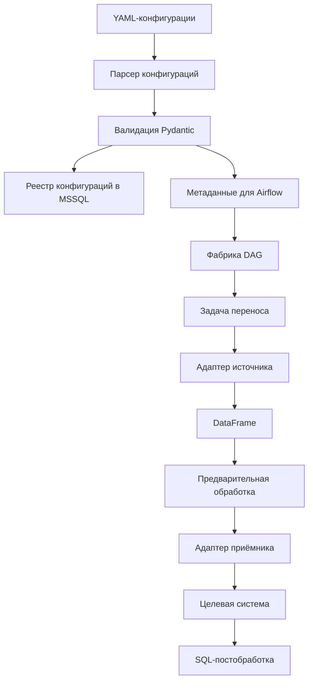

# Data Migration Framework

Конфигурационный фреймворк для переноса данных между источниками и целевыми системами на Python и Apache Airflow.

Проект позволяет описывать переносы данных в YAML-конфигурациях и запускать их через единый механизм выполнения. Вместо отдельного DAG и собственного кода для каждого переноса используются общая логика обработки, набор адаптеров для работы с источниками и приёмниками и централизованная конфигурация.

**Репозиторий содержит публичную демонстрационную версию**, основанную на первой итерации проекта. Разработка продолжилась после публикации этого снимка: в рабочей версии появились дополнительные возможности, не представленные в открытом коде.

## Основные возможности

- **Конфигурационное описание переносов.** Параметры источника, приёмника, обработки данных и расписания задаются в YAML.
- **Динамическое создание DAG.** Фабрика Airflow формирует задачи переноса на основе зарегистрированных конфигураций.
- **Модульная архитектура коннекторов.** Работа с системами-источниками и приёмниками отделена от основной логики переноса.
- **Валидация конфигураций.** Pydantic-модели проверяют структуру и обязательные параметры до выполнения переноса.
- **Предварительная обработка данных.** При необходимости к данным в памяти применяется пользовательская Python-логика.
- **SQL-постобработка.** После загрузки можно выполнить SQL-скрипт на стороне целевой системы.
- **Переиспользование компонентов.** Новые переносы можно добавлять через конфигурации без копирования всей логики выполнения.

## Архитектура



Схема отражает общий принцип работы публичной версии. Предварительная обработка и SQL-постобработка являются опциональными этапами.

## Как устроен проект

### 1. Конфигурации

Параметры переноса описываются декларативно: указываются источник, приёмник, дополнительные этапы обработки и параметры запуска.

Конфигурации проходят валидацию с помощью Pydantic. После проверки информация о переносах синхронизируется с реестром в MSSQL и используется для формирования DAG.

### 2. Оркестрация в Airflow

Фабрика DAG создаёт задачи на основании зарегистрированных конфигураций. Это позволяет отделить описание конкретного переноса от механизма его запуска и управления расписанием.

Отдельный DAG отвечает за периодический разбор конфигураций и обновление метаданных, используемых фабрикой.

### 3. Адаптеры источников и приёмников

Основная логика переноса не привязана напрямую к конкретному источнику. Взаимодействие с системами реализовано через отдельные адаптеры с общим интерфейсом чтения, записи и выполнения SQL.

Для подключения нового типа системы можно реализовать соответствующий адаптер и зарегистрировать его в реестре клиентов.

### 4. Обработка данных

В публичной версии данные передаются между этапами через `pandas.DataFrame`.

При необходимости можно подключить пользовательский модуль предварительной обработки. После загрузки данных в целевую систему может выполняться отдельный SQL-скрипт.

## Поддерживаемые системы в публичной версии

| Система | Возможности |
|---|---|
| Nextcloud | Чтение Excel-файлов и загрузка Excel-файлов |
| Microsoft SQL Server | Чтение таблиц, запись DataFrame, выполнение SQL |

Поддержка других систем и дополнительные способы извлечения данных, появившиеся в последующих итерациях, в этом публичном снимке не представлены.

## Развитие рабочей версии

После первой итерации проект продолжил развиваться. В рабочей версии были реализованы дополнительные возможности, в частности:

- **Поддержка ClickHouse** в качестве дополнительной системы для работы с данными.
- **Извлечение данных по SQL-запросу через `sql_file_path`.** Это позволяет задавать запрос к источнику вместо обязательного чтения всей таблицы целиком и тем самым лучше контролировать объём извлекаемых данных.

Эти возможности описывают развитие рабочей версии проекта и не относятся к коду, опубликованному в данном репозитории.

## Технологический стек

- **Python** — основная логика переноса и расширения функциональности.
- **Apache Airflow** — оркестрация и планирование задач.
- **Pandas** — промежуточное представление и обработка данных.
- **Pydantic** — валидация конфигураций.
- **PyYAML** — чтение YAML-конфигураций.
- **pyodbc** — взаимодействие с Microsoft SQL Server.
- **SQL** — извлечение, загрузка и постобработка данных.
- **Nextcloud WebDAV / HTTP** — взаимодействие с файловым хранилищем.

## Структура репозитория

```text
├── clients/                    # Клиенты и адаптеры источников и приёмников
├── configs/                    # Примеры конфигураций
├── dags/                       # Фабрика DAG и синхронизация конфигураций
├── data_pipelines/
│   ├── data_transform/         # Python-скрипты предобработки
│   └── data_migration/
│       ├── clients/            # Реализации адаптеров
│       ├── model.py            # Модели и валидация конфигураций
│       ├── parser_configs.py   # Разбор и регистрация конфигураций
│       ├── pipeline.py         # Основная логика переноса
│       └── run_postprocess.py  # Выполнение SQL-постобработки
├── sqls/                       # SQL-скрипты постобработки
└── utils/                      # Вспомогательные компоненты
```

## Ограничения и направления развития

Публичная версия представляет собой рабочий прототип фреймворка, а не универсальную платформу переноса данных. При проектировании были выбраны решения, позволившие быстрее реализовать основной сценарий и проверить архитектурный подход.

Известные ограничения:

- **Обработка данных в памяти.** Промежуточное использование `pandas.DataFrame` ограничивает объём данных доступной оперативной памятью.
- **Отсутствие универсальной пакетной передачи.** Чтение и запись между базами в публичной версии не реализованы как полноценный потоковый или пакетный механизм, поэтому перенос больших таблиц может быть неэффективным.
- **Ограниченный набор коннекторов.** В открытой версии представлены Nextcloud и Microsoft SQL Server.
- **Нет универсального механизма инкрементальной загрузки.** Управление водяными знаками, сверка результатов и другие сценарии инкрементального переноса требуют отдельной реализации.
- **Ограниченная обобщённость.** Для использования в другой инфраструктуре могут потребоваться адаптация конфигураций, настройка подключений и дополнительные проверки.

Эти ограничения определяют основные направления дальнейшего развития: пакетное чтение и запись, более эффективная обработка больших объёмов данных, расширение набора адаптеров и развитие механизмов контроля переноса.
